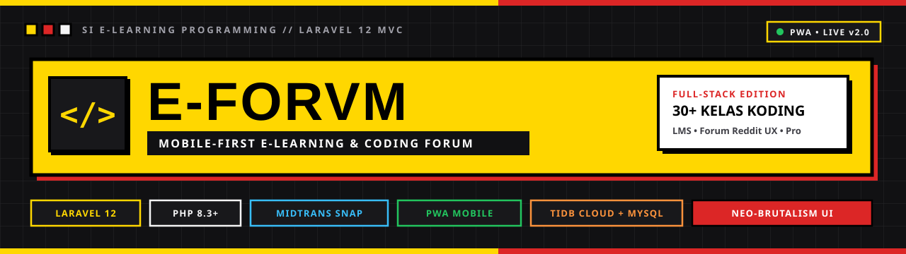
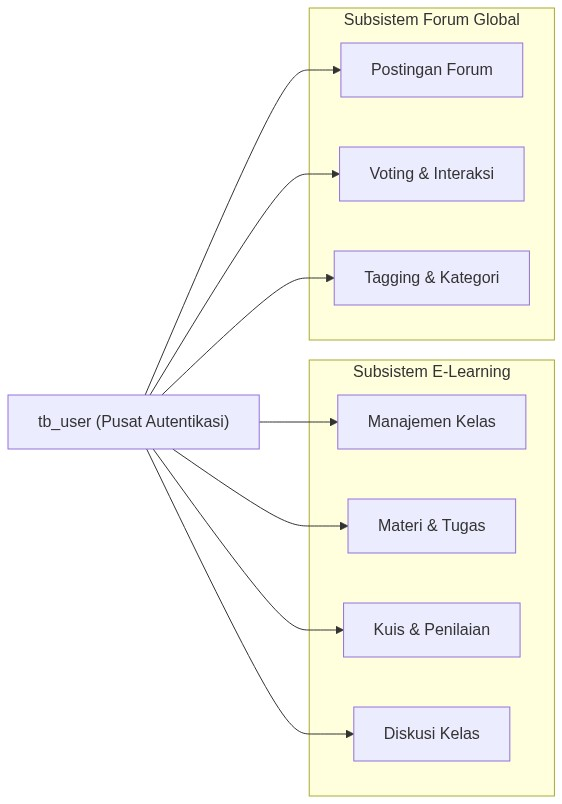
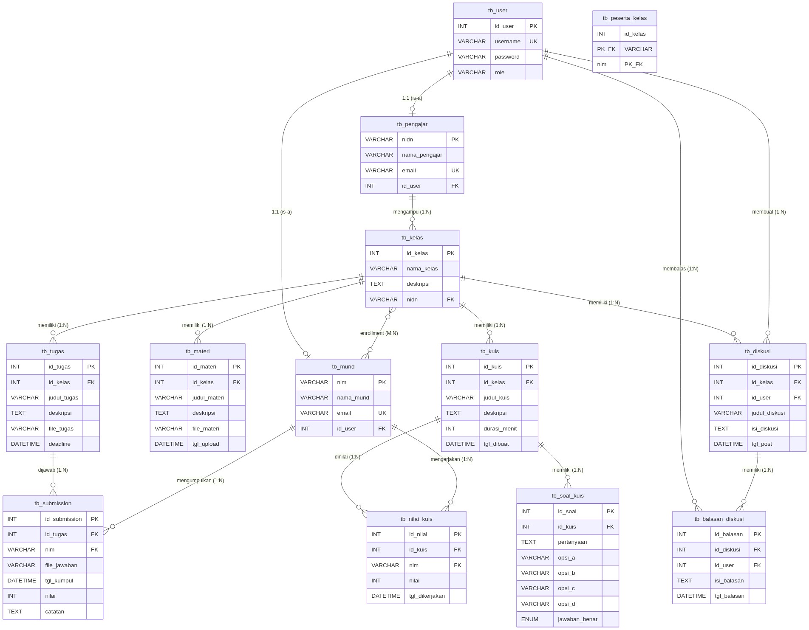
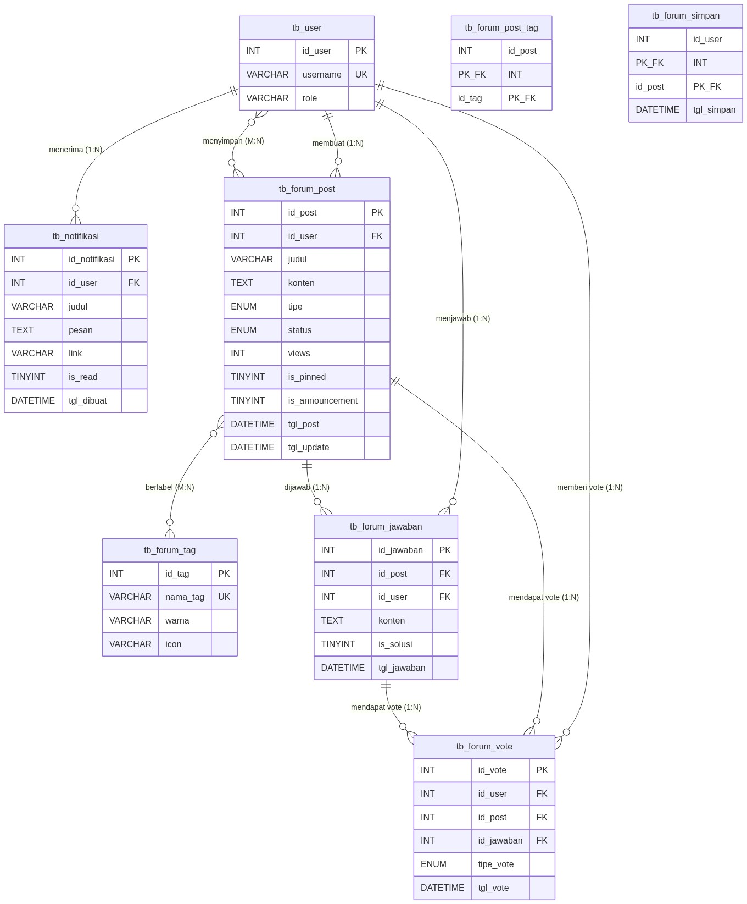

<div align="center">
  <a href="https://si-elearning-programming-production.up.railway.app">
    
  </a>

  <br><br>

  <a href="https://si-elearning-programming-production.up.railway.app">
    
  </a>
  <a href="https://github.com/hilalglitchly/SI_E-Learning_Programming/actions/workflows/tests.yml">
    
  </a>
  
  
  <a href="LICENSE">
    
  </a>

  <br>

  <a href="https://github.com/hilalglitchly/SI_E-Learning_Programming/stargazers">
    
  </a>
  <a href="https://github.com/hilalglitchly/SI_E-Learning_Programming/commits/main">
    
  </a>
  
  
  

  <p>
    <a href="https://si-elearning-programming-production.up.railway.app"><strong>Buka Live Demo</strong></a>
    &nbsp;&bull;&nbsp;
    <a href="#fitur-utama">Fitur Utama</a>
    &nbsp;&bull;&nbsp;
    <a href="#arsitektur--perancangan-database">Arsitektur &amp; ERD</a>
    &nbsp;&bull;&nbsp;
    <a href="#instalasi-lokal">Instalasi Lokal</a>
    &nbsp;&bull;&nbsp;
    <a href="#deploy-produksi-railway--tidb-cloud">Deploy Produksi</a>
    &nbsp;&bull;&nbsp;
    <a href="#akun-demo-pengujian">Akun Demo</a>
  </p>
</div>

---

## THE COMPLETE NEO-BRUTALIST E-LEARNING &amp; PROGRAMMING FORUM

**E-FORVM** (*SI E-Learning Programming*) adalah platform pembelajaran pemrograman **Full-Stack Laravel 12 (MVC)** yang menggabungkan **Learning Management System (LMS) multi-role**, **forum diskusi komunitas gaya Reddit**, **pembayaran langganan Pro terintegrasi Midtrans Snap**, serta pengalaman **Progressive Web App (PWA) mobile-first** dengan estetika **Neo-Brutalism** (mendukung Light &amp; Dark Mode tanpa FOUC).

Aplikasi ini dirancang siap produksi untuk deployment container Docker di **Railway (Region SEA Singapore)** dengan database **TiDB Cloud / MySQL 8**, proteksi keamanan berlapis, serta cakupan **29 pengujian otomatis PHPUnit (367 assertions)**.

---

## FITUR UTAMA

<table>
  <tr>
    <td width="50%" valign="top">
      <h3>LMS &amp; Ruang Kelas Interaktif</h3>
      <ul>
        <li><strong>30+ Kelas Pemrograman</strong> (Gratis &amp; Pro) dengan sistem enrollment &amp; progres belajar murid.</li>
        <li><strong>Modul Materi &amp; Video Embed</strong> mendukung lampiran file privat + embed aman YouTube/Vimeo.</li>
        <li><strong>Tugas &amp; Penilaian</strong> dengan pengumpulan file privat, tenggat waktu, nilai, dan umpan balik pengajar.</li>
        <li><strong>Engine Kuis Berbatas Waktu</strong> dengan validasi durasi <em>server-side</em>, proteksi submit ganda, dan penilaian otomatis.</li>
      </ul>
    </td>
    <td width="50%" valign="top">
      <h3>Forum Diskusi E-FORVM (Reddit-Style Mobile)</h3>
      <ul>
        <li><strong>Desktop 3-Kolom &amp; Mobile Gaya Reddit</strong> dengan kartu feed <em>edge-to-edge</em> dan action bar pill bawah (<code>▲ skor ▼</code>, komentar, simpan, bagikan).</li>
        <li><strong>Filter Lengkap</strong> berdasarkan <em>Hot</em>, <em>Baru</em>, <em>Top</em>, <em>Belum Solved</em>, <em>Tersimpan</em>, tipe posting, dan strip topik <code>#tag</code>.</li>
        <li><strong>Rich Editor &amp; Cuplikan Kode</strong> menggunakan Quill.js + Highlight.js dengan sanitasi HTML <em>allowlist</em>.</li>
        <li><strong>Tandai Solusi Terbaik</strong> oleh pemilik pertanyaan/Admin + leaderboard Top Kontributor.</li>
      </ul>
    </td>
  </tr>
  <tr>
    <td width="50%" valign="top">
      <h3>Langganan Pro &amp; Midtrans Snap</h3>
      <ul>
        <li><strong>Checkout Midtrans Snap</strong> (QRIS, Virtual Account, E-Wallet, Kartu) dengan penguncian transaksi paralel.</li>
        <li><strong>Webhook Otomatis</strong> di <code>/api/midtrans/webhook</code> dengan verifikasi signature <strong>SHA-512</strong> &amp; validasi <code>gross_amount</code> idempoten.</li>
        <li><strong>Sinkronisasi Core API &amp; Pembatalan</strong> langsung dari sisi Murid maupun panel Admin.</li>
        <li><strong>Struk Invoice Siap Cetak</strong>, pengaturan harga paket dinamis, serta rekap keuangan Pro untuk Pimpinan.</li>
      </ul>
    </td>
    <td width="50%" valign="top">
      <h3>Mobile-First PWA, Keamanan &amp; Performa</h3>
      <ul>
        <li><strong>Installable PWA</strong> (<code>manifest.webmanifest</code>, Service Worker <code>sw.js</code>, halaman <code>offline.html</code>).</li>
        <li><strong>App Shell Khusus Mobile</strong>: App Header Profil &amp; Notifikasi, Bottom Bar navigasi, Menu Akun gaya native, &amp; Pull-to-Refresh.</li>
        <li><strong>Optimasi Kecepatan</strong>: Cross-Document View Transitions, Speculation Rules prefetch, Cookie Session, File Cache + auto-invalidation, &amp; Apache Gzip.</li>
        <li><strong>Keamanan Produksi</strong>: CSP, HSTS, Rate Limiting, private file streaming, verifikasi email signed-URL, &amp; lupa password.</li>
      </ul>
    </td>
  </tr>
</table>

---

## MATRIKS HAK AKSES MULTI-ROLE

| Role | Dashboard &amp; Kelas | Tugas &amp; Kuis | Forum E-FORVM | Langganan Pro &amp; Laporan |
| :--- | :--- | :--- | :--- | :--- |
| **Murid** | Daftar kelas, akses materi &amp; progres belajar | Kumpul tugas, kerjakan kuis berbatas waktu | Buat post, jawab, vote, simpan, tandai solusi | Upgrade Pro via Midtrans, unduh/cetak invoice |
| **Pengajar** | Kelola kelas ampu, upload materi &amp; video | Buat tugas &amp; kuis, kelola soal, beri nilai | Berdiskusi, buat pengumuman pinned | — |
| **Admin** | CRUD seluruh pengguna &amp; kelas (Gratis/Pro) | Akses penuh moderasi materi, tugas &amp; kuis | Moderasi penuh edit/hapus post &amp; jawaban | Kelola paket &amp; transaksi Midtrans, panel verifikasi webhook, laporan sistem |
| **Pimpinan** | Pantau statistik akademik &amp; rekap seluruh kelas | Read-only pemantauan progres | Berpartisipasi di forum diskusi | Ringkasan keuangan Pro &amp; cetak laporan rekapitulasi |

---

## ARSITEKTUR &amp; PERANCANGAN DATABASE

<table>
  <tr>
    <td width="50%" align="center">
      <strong>Arsitektur Sistem</strong><br><br>
      <a href="docs/diagrams/arsitektur_sistem.png">
        
      </a>
    </td>
    <td width="50%" align="center">
      <strong>ERD Modul E-Learning</strong><br><br>
      <a href="docs/diagrams/erd_elearning.png">
        
      </a>
    </td>
  </tr>
  <tr>
    <td colspan="2" align="center">
      <strong>ERD Modul Forum Diskusi (E-FORVM)</strong><br><br>
      <a href="docs/diagrams/erd_forum.png">
        
      </a>
    </td>
  </tr>
</table>

---

## INSTALASI LOKAL

### Prasyarat
- **PHP 8.2 / 8.3+** (ekstensi `pdo_mysql`, `pdo_sqlite`, `mbstring`, `intl`, `gd`, `zip`, `bcmath`)
- **Composer 2.x**
- **MySQL 8 / MariaDB / TiDB** (Laragon direkomendasikan di Windows)

### Langkah Cepat
```bash
# 1. Clone repository
git clone https://github.com/hilalglitchly/SI_E-Learning_Programming.git
cd SI_E-Learning_Programming

# 2. Install dependency PHP
composer install

# 3. Salin konfigurasi environment & buat APP_KEY
cp .env.example .env
php artisan key:generate

# 4. Atur kredensial DB di .env (db_elearning_laravel), lalu migrasi & seed data demo
php artisan migrate --seed

# 5. Jalankan server pengembangan lokal
php artisan serve
```

Buka aplikasi di **`http://127.0.0.1:8000`**.

### Menjalankan Pengujian Otomatis (PHPUnit)
Suite pengujian berjalan secara terisolasi menggunakan SQLite `:memory:` (**29 tests, 367 assertions**):

```bash
php -d extension=pdo_sqlite vendor/bin/phpunit
```

---

## AKUN DEMO PENGUJIAN

<details>
<summary><strong>Klik untuk melihat daftar akun demo hasil <code>DatabaseSeeder</code> (Password: <code>password123</code>)</strong></summary>

<br>

Semua akun demo di bawah ini sudah terverifikasi email dan memakai password default: **`password123`**

| Role | Username | Nama | Hak Akses Utama |
| :--- | :--- | :--- | :--- |
| **Admin** | `admin` | Administrator Sistem | Kelola seluruh user, kelas, transaksi Midtrans, paket Pro, &amp; laporan |
| **Pimpinan** | `pimpinan` | Pimpinan Institusi | Dashboard rekapitulasi akademik &amp; ringkasan pendapatan langganan Pro |
| **Pengajar** | `dosen_rina` | Rina Wijaya, M.T. | Kelola kelas, materi/video, tugas, penilaian, &amp; kuis |
| **Murid** | `student_adit` | Adit Pratama | Ikuti kelas, kumpul tugas, kerjakan kuis, forum E-FORVM, &amp; checkout Pro |

</details>

---

## DEPLOY PRODUKSI (RAILWAY + TIDB CLOUD)

<details>
<summary><strong>Klik untuk membuka panduan Environment Variables &amp; Webhook Midtrans</strong></summary>

<br>

Repository ini sudah dilengkapi [`Dockerfile`](Dockerfile) (PHP 8.3 Apache + OPcache + `mod_deflate`/`mod_expires`) dan [`docker/render-start.sh`](docker/render-start.sh) yang otomatis menjalankan optimasi cache Laravel serta migrasi database saat container menyala.

1. **Deploy Region:** Pilih **Southeast Asia (Singapore)** di Railway Settings agar satu region dengan TiDB Cloud Serverless Singapore.
2. **Environment Variables utama di Railway:**
   ```env
   APP_NAME="E-FORVM"
   APP_ENV=production
   APP_DEBUG=false
   APP_KEY=base64:...
   APP_URL=https://si-elearning-programming-production.up.railway.app
   CORS_ALLOWED_ORIGINS=https://si-elearning-programming-production.up.railway.app
   TRUSTED_PROXIES=*
   LOG_CHANNEL=stderr
   SESSION_DRIVER=cookie
   SESSION_SECURE_COOKIE=true
   CACHE_STORE=file
   DB_CONNECTION=mysql
   DB_HOST=<tidb-cloud-host>
   DB_PORT=4000
   DB_DATABASE=db_elearning_laravel
   DB_USERNAME=<tidb-user>
   DB_PASSWORD=<tidb-password>
   MYSQL_ATTR_SSL_CA=/etc/ssl/certs/ca-certificates.crt
   MIDTRANS_SERVER_KEY=<midtrans-server-key>
   MIDTRANS_CLIENT_KEY=<midtrans-client-key>
   MIDTRANS_IS_PRODUCTION=false
   RUN_MIGRATIONS=true
   RUN_SEED_ONCE=true
   ```
3. **Konfigurasi Webhook Midtrans:**
   Masuk ke **Midtrans Dashboard → Settings → Configuration → Payment Notification URL**, lalu pasang:
   ```text
   https://si-elearning-programming-production.up.railway.app/api/midtrans/webhook
   ```
   *(Admin juga dapat melihat status konfigurasi dan menyalin URL webhook 1-klik melalui halaman `/admin/langganan`.)*

</details>

---

## STRUKTUR DIREKTORI UTAMA

<details>
<summary><strong>Klik untuk melihat ringkasan struktur proyek</strong></summary>

```text
SI_E-Learning_Programming/
├── .github/workflows/       # GitHub Actions CI (PHPUnit + Blade compile check)
├── app/
│   ├── Helpers/             # Sanitasi HTML, preview kode, video embed, timeAgo
│   ├── Http/
│   │   ├── Controllers/     # Auth, Dashboard, Kelas, Tugas, Kuis, Forum, Langganan, Admin, Laporan
│   │   └── Middleware/      # RoleMiddleware, SecurityHeaders (CSP & HSTS)
│   └── Models/              # Eloquent models + auto-invalidation hooks
├── config/                  # Session (cookie), Cache (file), Midtrans services
├── database/
│   ├── migrations/          # Skema LMS, Forum, Langganan Midtrans, & indexes
│   └── seeders/             # 34 pengguna, 30 kelas, materi, tugas, kuis, forum demo
├── docker/                  # Startup script produksi (render-start.sh)
├── docs/                    # Banner repo, diagram arsitektur, & ERD
├── public/                  # CSS (style.css, forum.css), JS, manifest PWA, sw.js
├── resources/views/         # Blade layouts, partials, LMS, Forum, Profil, Admin
├── routes/                  # web.php & api.php (/api/midtrans/webhook)
└── tests/Feature/           # 29 feature & security tests (PHPUnit 11)
```

</details>

---

<div align="center">
  <p>
    Dibangun dengan <strong>Laravel 12</strong> &bull;
    <a href="https://github.com/hilalglitchly/SI_E-Learning_Programming/graphs/contributors">Kontributor</a> &bull;
    <a href="LICENSE">Lisensi MIT</a>
  </p>
</div>
