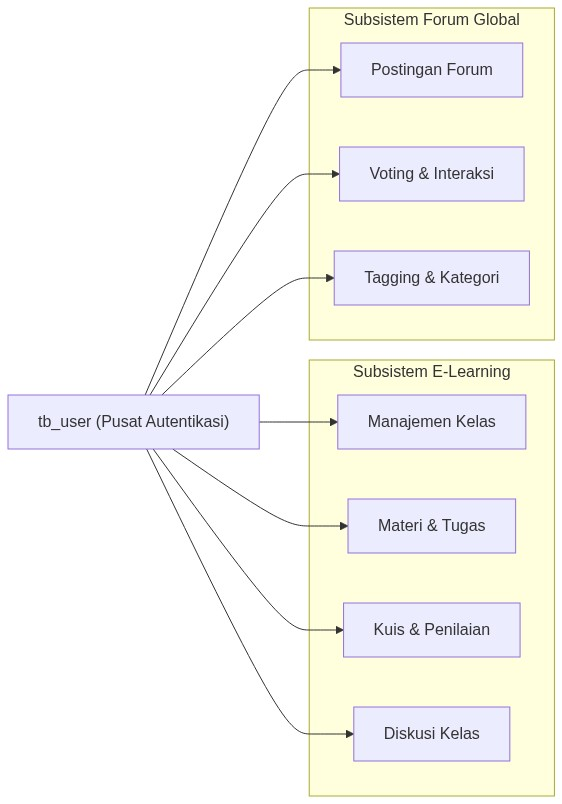
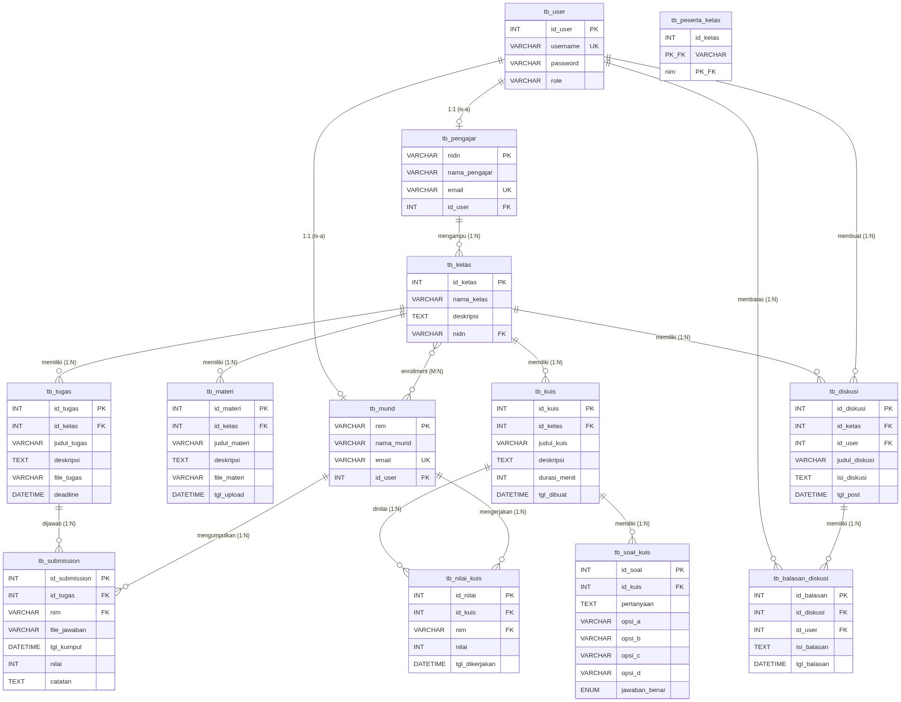
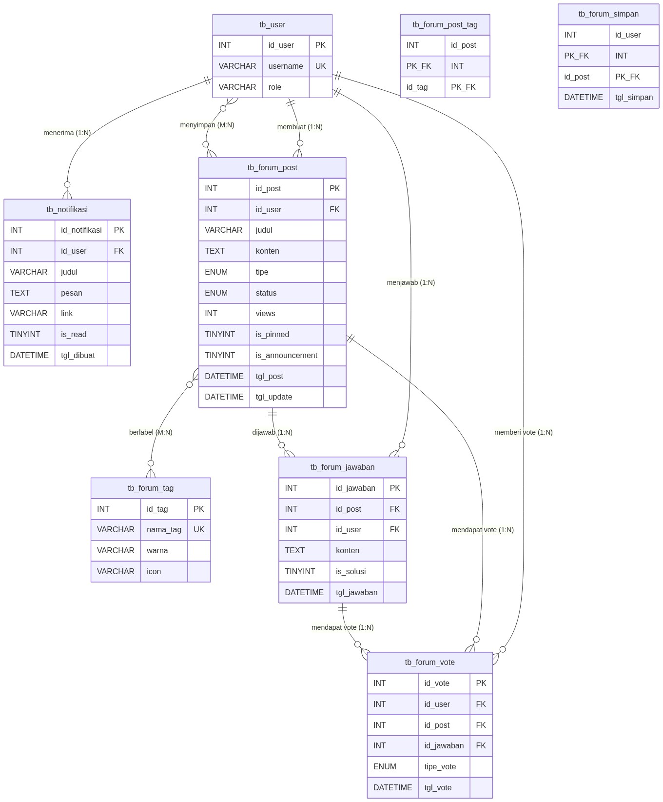

# 📐 Perancangan Database — Sistem E-Learning Programming & Forum Diskusi

**Nama Database**: `db_elearning`  
**DBMS**: MySQL / MariaDB  
**Charset**: UTF-8 (utf8mb4)  
**Proyek**: Sistem Informasi E-Learning Programming + Forum Diskusi  

---

## 1. Gambaran Umum Sistem

Sistem ini terdiri dari **dua subsistem utama** yang saling terintegrasi melalui tabel `tb_user` sebagai pusat autentikasi:

### Aktor Sistem (Role-Based Access Control)

| No | Role | Hak Akses |
|:---:|---|---|
| 1 | **Admin** | CRUD semua data, kelola user, laporan, kelola forum |
| 2 | **Pimpinan** | Lihat laporan, monitoring statistik |
| 3 | **Pengajar** | CRUD kelas/materi/tugas/kuis, penilaian, posting forum, pin/announce |
| 4 | **Murid** | Enroll kelas, submit tugas, kerjakan kuis, diskusi, posting forum |

---

## 2. Daftar Seluruh Tabel (20 Tabel)

### Subsistem E-Learning (13 Tabel)
| No | Nama Tabel | Fungsi | Jenis |
|:---:|---|---|---|
| 1 | `tb_user` | Menyimpan data autentikasi semua pengguna | Master |
| 2 | `tb_pengajar` | Menyimpan profil lengkap dosen/pengajar | Master |
| 3 | `tb_murid` | Menyimpan profil lengkap mahasiswa/murid | Master |
| 4 | `tb_kelas` | Menyimpan data kelas pembelajaran | Master |
| 5 | `tb_peserta_kelas` | Relasi many-to-many murid ↔ kelas (enrollment) | Pivot |
| 6 | `tb_materi` | Menyimpan konten materi per kelas | Transaksi |
| 7 | `tb_tugas` | Menyimpan penugasan per kelas | Transaksi |
| 8 | `tb_submission` | Menyimpan jawaban/pengumpulan tugas murid | Transaksi |
| 9 | `tb_diskusi` | Menyimpan thread diskusi dalam kelas | Transaksi |
| 10 | `tb_balasan_diskusi` | Menyimpan balasan diskusi dalam kelas | Transaksi |
| 11 | `tb_kuis` | Menyimpan data kuis per kelas | Transaksi |
| 12 | `tb_soal_kuis` | Menyimpan soal pilihan ganda kuis | Transaksi |
| 13 | `tb_nilai_kuis` | Menyimpan hasil/nilai kuis murid | Transaksi |

### Subsistem Forum Global (7 Tabel)
| No | Nama Tabel | Fungsi | Jenis |
|:---:|---|---|---|
| 14 | `tb_notifikasi` | Menyimpan notifikasi real-time per user | Transaksi |
| 15 | `tb_forum_tag` | Menyimpan kategori/label topik forum | Master |
| 16 | `tb_forum_post` | Menyimpan postingan utama forum | Transaksi |
| 17 | `tb_forum_jawaban` | Menyimpan jawaban/komentar pada postingan | Transaksi |
| 18 | `tb_forum_vote` | Menyimpan data upvote/downvote | Transaksi |
| 19 | `tb_forum_post_tag` | Relasi many-to-many post ↔ tag | Pivot |
| 20 | `tb_forum_simpan` | Menyimpan bookmark/postingan tersimpan | Transaksi |

> [!NOTE]
> Tabel `tb_forum_media` juga sudah dibuat di migrasi untuk menyimpan lampiran media (gambar/video). Tabel ini bersifat opsional dan belum aktif dipakai di versi saat ini.

---

## 3. Kamus Data (Data Dictionary)

### 3.1 `tb_user` — Tabel Utama Pengguna
> Pusat autentikasi seluruh sistem. Setiap aktor (Admin, Pimpinan, Pengajar, Murid) memiliki satu record di tabel ini.

| # | Kolom | Tipe Data | Constraint | Keterangan |
|:---:|---|---|---|---|
| 1 | `id_user` | INT | PK, AI | ID unik pengguna (auto increment) |
| 2 | `username` | VARCHAR(50) | UNIQUE, NOT NULL | Nama login (tidak boleh duplikat) |
| 3 | `password` | VARCHAR(255) | NOT NULL | Hash password (password_hash) |
| 4 | `role` | VARCHAR(20) | NOT NULL | Peran: Admin / Pimpinan / Pengajar / Murid |

---

### 3.2 `tb_pengajar` — Profil Dosen
> Ekstensi tabel `tb_user` khusus untuk role Pengajar. Berelasi 1:1 dengan `tb_user`.

| # | Kolom | Tipe Data | Constraint | Keterangan |
|:---:|---|---|---|---|
| 1 | `nidn` | VARCHAR(20) | **PK** | Nomor Induk Dosen Nasional |
| 2 | `nama_pengajar` | VARCHAR(100) | NOT NULL | Nama lengkap beserta gelar |
| 3 | `email` | VARCHAR(100) | UNIQUE | Alamat email dosen |
| 4 | `id_user` | INT | FK → `tb_user(id_user)` ON DELETE CASCADE | Referensi ke tabel user |

---

### 3.3 `tb_murid` — Profil Mahasiswa
> Ekstensi tabel `tb_user` khusus untuk role Murid. Berelasi 1:1 dengan `tb_user`.

| # | Kolom | Tipe Data | Constraint | Keterangan |
|:---:|---|---|---|---|
| 1 | `nim` | VARCHAR(20) | **PK** | Nomor Induk Mahasiswa |
| 2 | `nama_murid` | VARCHAR(100) | NOT NULL | Nama lengkap mahasiswa |
| 3 | `email` | VARCHAR(100) | UNIQUE | Alamat email mahasiswa |
| 4 | `id_user` | INT | FK → `tb_user(id_user)` ON DELETE CASCADE | Referensi ke tabel user |

---

### 3.4 `tb_kelas` — Data Kelas Pembelajaran
> Setiap kelas diampu oleh satu pengajar, dan diikuti oleh banyak murid.

| # | Kolom | Tipe Data | Constraint | Keterangan |
|:---:|---|---|---|---|
| 1 | `id_kelas` | INT | PK, AI | ID unik kelas |
| 2 | `nama_kelas` | VARCHAR(100) | NOT NULL | Nama kelas (misal: "Modern JavaScript & React") |
| 3 | `deskripsi` | TEXT | — | Deskripsi isi dan tujuan kelas |
| 4 | `nidn` | VARCHAR(20) | FK → `tb_pengajar(nidn)` ON DELETE SET NULL | NIDN pengajar yang mengampu |

---

### 3.5 `tb_peserta_kelas` — Enrollment Murid ke Kelas *(Tabel Pivot)*
> Relasi Many-to-Many antara `tb_murid` dan `tb_kelas`. Satu murid bisa ikut banyak kelas, satu kelas bisa memiliki banyak murid.

| # | Kolom | Tipe Data | Constraint | Keterangan |
|:---:|---|---|---|---|
| 1 | `id_kelas` | INT | **PK (composite)**, FK → `tb_kelas` ON DELETE CASCADE | ID kelas yang diikuti |
| 2 | `nim` | VARCHAR(20) | **PK (composite)**, FK → `tb_murid` ON DELETE CASCADE | NIM murid yang mengikuti |

---

### 3.6 `tb_materi` — Materi Pembelajaran
> Setiap kelas dapat memiliki banyak materi. Materi berisi konten deskriptif dan opsional file lampiran.

| # | Kolom | Tipe Data | Constraint | Keterangan |
|:---:|---|---|---|---|
| 1 | `id_materi` | INT | PK, AI | ID unik materi |
| 2 | `id_kelas` | INT | FK → `tb_kelas` ON DELETE CASCADE | Kelas tempat materi berada |
| 3 | `judul_materi` | VARCHAR(150) | NOT NULL | Judul materi |
| 4 | `deskripsi` | TEXT | — | Konten materi (Rich Text / HTML) |
| 5 | `file_materi` | VARCHAR(255) | — | Nama file lampiran (PDF, PPT, dll) |
| 6 | `tgl_upload` | DATETIME | DEFAULT CURRENT_TIMESTAMP | Waktu upload materi |

---

### 3.7 `tb_tugas` — Penugasan
> Pengajar membuat tugas dengan deadline. Murid yang terdaftar di kelas tersebut harus mengumpulkan jawaban.

| # | Kolom | Tipe Data | Constraint | Keterangan |
|:---:|---|---|---|---|
| 1 | `id_tugas` | INT | PK, AI | ID unik tugas |
| 2 | `id_kelas` | INT | FK → `tb_kelas` ON DELETE CASCADE | Kelas tempat tugas berada |
| 3 | `judul_tugas` | VARCHAR(150) | NOT NULL | Judul tugas |
| 4 | `deskripsi` | TEXT | — | Deskripsi/instruksi tugas (Rich Text) |
| 5 | `file_tugas` | VARCHAR(255) | — | File referensi/lampiran tugas |
| 6 | `deadline` | DATETIME | — | Batas waktu pengumpulan |

---

### 3.8 `tb_submission` — Pengumpulan Jawaban Tugas
> Murid mengunggah file jawaban. Pengajar memberikan nilai dan catatan.

| # | Kolom | Tipe Data | Constraint | Keterangan |
|:---:|---|---|---|---|
| 1 | `id_submission` | INT | PK, AI | ID unik submission |
| 2 | `id_tugas` | INT | FK → `tb_tugas` ON DELETE CASCADE | Tugas yang dijawab |
| 3 | `nim` | VARCHAR(20) | FK → `tb_murid` ON DELETE CASCADE | NIM murid yang mengumpulkan |
| 4 | `file_jawaban` | VARCHAR(255) | — | File jawaban yang diunggah |
| 5 | `tgl_kumpul` | DATETIME | DEFAULT CURRENT_TIMESTAMP | Waktu pengumpulan |
| 6 | `nilai` | INT | DEFAULT NULL | Nilai dari pengajar (0–100) |
| 7 | `catatan` | TEXT | — | Catatan/feedback dari pengajar |

---

### 3.9 `tb_diskusi` — Diskusi dalam Kelas
> Thread diskusi yang terikat pada kelas tertentu (berbeda dari Forum Global).

| # | Kolom | Tipe Data | Constraint | Keterangan |
|:---:|---|---|---|---|
| 1 | `id_diskusi` | INT | PK, AI | ID unik diskusi |
| 2 | `id_kelas` | INT | FK → `tb_kelas` ON DELETE CASCADE | Kelas tempat diskusi dibuat |
| 3 | `id_user` | INT | FK → `tb_user` ON DELETE CASCADE | Pembuat diskusi |
| 4 | `judul_diskusi` | VARCHAR(150) | NOT NULL | Judul thread diskusi |
| 5 | `isi_diskusi` | TEXT | — | Konten diskusi (Rich Text) |
| 6 | `tgl_post` | DATETIME | DEFAULT CURRENT_TIMESTAMP | Waktu posting |

---

### 3.10 `tb_balasan_diskusi` — Balasan Diskusi Kelas

| # | Kolom | Tipe Data | Constraint | Keterangan |
|:---:|---|---|---|---|
| 1 | `id_balasan` | INT | PK, AI | ID unik balasan |
| 2 | `id_diskusi` | INT | FK → `tb_diskusi` ON DELETE CASCADE | Thread yang dibalas |
| 3 | `id_user` | INT | FK → `tb_user` ON DELETE CASCADE | Pembuat balasan |
| 4 | `isi_balasan` | TEXT | — | Konten balasan (Rich Text) |
| 5 | `tgl_balasan` | DATETIME | DEFAULT CURRENT_TIMESTAMP | Waktu balas |

---

### 3.11 `tb_kuis` — Data Kuis

| # | Kolom | Tipe Data | Constraint | Keterangan |
|:---:|---|---|---|---|
| 1 | `id_kuis` | INT | PK, AI | ID unik kuis |
| 2 | `id_kelas` | INT | FK → `tb_kelas` ON DELETE CASCADE | Kelas tempat kuis |
| 3 | `judul_kuis` | VARCHAR(150) | NOT NULL | Judul kuis |
| 4 | `deskripsi` | TEXT | — | Deskripsi/petunjuk kuis |
| 5 | `durasi_menit` | INT | — | Batas waktu pengerjaan (menit) |
| 6 | `tgl_dibuat` | DATETIME | DEFAULT CURRENT_TIMESTAMP | Waktu kuis dibuat |

---

### 3.12 `tb_soal_kuis` — Soal Pilihan Ganda

| # | Kolom | Tipe Data | Constraint | Keterangan |
|:---:|---|---|---|---|
| 1 | `id_soal` | INT | PK, AI | ID unik soal |
| 2 | `id_kuis` | INT | FK → `tb_kuis` ON DELETE CASCADE | Kuis induk |
| 3 | `pertanyaan` | TEXT | NOT NULL | Isi pertanyaan |
| 4 | `opsi_a` | VARCHAR(255) | — | Pilihan jawaban A |
| 5 | `opsi_b` | VARCHAR(255) | — | Pilihan jawaban B |
| 6 | `opsi_c` | VARCHAR(255) | — | Pilihan jawaban C |
| 7 | `opsi_d` | VARCHAR(255) | — | Pilihan jawaban D |
| 8 | `jawaban_benar` | ENUM('A','B','C','D') | NOT NULL | Kunci jawaban |

---

### 3.13 `tb_nilai_kuis` — Nilai Hasil Kuis

| # | Kolom | Tipe Data | Constraint | Keterangan |
|:---:|---|---|---|---|
| 1 | `id_nilai` | INT | PK, AI | ID unik nilai |
| 2 | `id_kuis` | INT | FK → `tb_kuis` ON DELETE CASCADE | Kuis yang dikerjakan |
| 3 | `nim` | VARCHAR(20) | FK → `tb_murid` ON DELETE CASCADE | NIM murid |
| 4 | `nilai` | INT | — | Nilai akhir (0–100) |
| 5 | `tgl_dikerjakan` | DATETIME | DEFAULT CURRENT_TIMESTAMP | Waktu selesai mengerjakan |

---

### 3.14 `tb_notifikasi` — Notifikasi Real-Time

| # | Kolom | Tipe Data | Constraint | Keterangan |
|:---:|---|---|---|---|
| 1 | `id_notifikasi` | INT | PK, AI | ID unik notifikasi |
| 2 | `id_user` | INT | FK → `tb_user` ON DELETE CASCADE | Penerima notifikasi |
| 3 | `judul` | VARCHAR(150) | — | Judul singkat notifikasi |
| 4 | `pesan` | TEXT | — | Isi pesan notifikasi |
| 5 | `link` | VARCHAR(255) | — | URL redirect saat diklik |
| 6 | `is_read` | TINYINT(1) | DEFAULT 0 | Status baca (0=belum, 1=sudah) |
| 7 | `tgl_dibuat` | DATETIME | DEFAULT CURRENT_TIMESTAMP | Waktu notifikasi dibuat |

---

### 3.15 `tb_forum_tag` — Kategori/Label Topik Forum

| # | Kolom | Tipe Data | Constraint | Keterangan |
|:---:|---|---|---|---|
| 1 | `id_tag` | INT | PK, AI | ID unik tag |
| 2 | `nama_tag` | VARCHAR(50) | NOT NULL, UNIQUE | Nama tag (misal: "JavaScript", "React") |
| 3 | `warna` | VARCHAR(7) | DEFAULT '#FFD700' | Kode warna hex untuk tampilan UI |
| 4 | `icon` | VARCHAR(50) | DEFAULT 'bx-code-alt' | Class icon Boxicons |

---

### 3.16 `tb_forum_post` — Postingan Forum Global

| # | Kolom | Tipe Data | Constraint | Keterangan |
|:---:|---|---|---|---|
| 1 | `id_post` | INT | PK, AI | ID unik postingan |
| 2 | `id_user` | INT | FK → `tb_user` ON DELETE CASCADE, NOT NULL | Pembuat postingan |
| 3 | `judul` | VARCHAR(255) | NOT NULL | Judul topik/thread |
| 4 | `konten` | TEXT | NOT NULL | Isi postingan (Rich Text / HTML) |
| 5 | `tipe` | ENUM('pertanyaan','diskusi','berbagi') | DEFAULT 'pertanyaan' | Jenis postingan |
| 6 | `status` | ENUM('open','solved') | DEFAULT 'open' | Status penyelesaian (untuk pertanyaan) |
| 7 | `views` | INT | DEFAULT 0 | Jumlah kali dilihat |
| 8 | `is_pinned` | TINYINT(1) | DEFAULT 0 | Apakah disematkan di atas |
| 9 | `is_announcement` | TINYINT(1) | DEFAULT 0 | Apakah bersifat pengumuman |
| 10 | `tgl_post` | DATETIME | DEFAULT CURRENT_TIMESTAMP | Waktu posting |
| 11 | `tgl_update` | DATETIME | DEFAULT CURRENT_TIMESTAMP ON UPDATE | Waktu terakhir diperbarui |

---

### 3.17 `tb_forum_jawaban` — Jawaban pada Postingan Forum

| # | Kolom | Tipe Data | Constraint | Keterangan |
|:---:|---|---|---|---|
| 1 | `id_jawaban` | INT | PK, AI | ID unik jawaban |
| 2 | `id_post` | INT | FK → `tb_forum_post` ON DELETE CASCADE, NOT NULL | Postingan yang dijawab |
| 3 | `id_user` | INT | FK → `tb_user` ON DELETE CASCADE, NOT NULL | Pembuat jawaban |
| 4 | `konten` | TEXT | NOT NULL | Isi jawaban (Rich Text) |
| 5 | `is_solusi` | TINYINT(1) | DEFAULT 0 | Ditandai sebagai jawaban terbaik |
| 6 | `tgl_jawaban` | DATETIME | DEFAULT CURRENT_TIMESTAMP | Waktu menjawab |

---

### 3.18 `tb_forum_vote` — Sistem Voting (Upvote/Downvote)

| # | Kolom | Tipe Data | Constraint | Keterangan |
|:---:|---|---|---|---|
| 1 | `id_vote` | INT | PK, AI | ID unik vote |
| 2 | `id_user` | INT | FK → `tb_user` ON DELETE CASCADE, NOT NULL | User yang melakukan vote |
| 3 | `id_post` | INT | FK → `tb_forum_post` ON DELETE CASCADE, NULLABLE | Vote untuk postingan (NULL jika vote jawaban) |
| 4 | `id_jawaban` | INT | FK → `tb_forum_jawaban` ON DELETE CASCADE, NULLABLE | Vote untuk jawaban (NULL jika vote post) |
| 5 | `tipe_vote` | ENUM('up','down') | NOT NULL | Jenis vote |
| 6 | `tgl_vote` | DATETIME | DEFAULT CURRENT_TIMESTAMP | Waktu vote |

> **Constraint Unik:** `UNIQUE(id_user, id_post)` dan `UNIQUE(id_user, id_jawaban)` — mencegah satu user melakukan multiple vote pada item yang sama.

---

### 3.19 `tb_forum_post_tag` — Relasi Post ↔ Tag *(Tabel Pivot)*
> Relasi Many-to-Many. Satu postingan bisa memiliki maks. 5 tag, satu tag bisa dipakai di banyak postingan.

| # | Kolom | Tipe Data | Constraint | Keterangan |
|:---:|---|---|---|---|
| 1 | `id_post` | INT | **PK (composite)**, FK → `tb_forum_post` ON DELETE CASCADE | ID postingan |
| 2 | `id_tag` | INT | **PK (composite)**, FK → `tb_forum_tag` ON DELETE CASCADE | ID tag |

---

### 3.20 `tb_forum_simpan` — Bookmark/Postingan Tersimpan *(Tabel Pivot)*
> Relasi Many-to-Many. Satu user bisa menyimpan banyak postingan, satu postingan bisa disimpan oleh banyak user.

| # | Kolom | Tipe Data | Constraint | Keterangan |
|:---:|---|---|---|---|
| 1 | `id_user` | INT | **PK (composite)**, FK → `tb_user` ON DELETE CASCADE | User yang menyimpan |
| 2 | `id_post` | INT | **PK (composite)**, FK → `tb_forum_post` ON DELETE CASCADE | Postingan yang disimpan |
| 3 | `tgl_simpan` | DATETIME | DEFAULT CURRENT_TIMESTAMP | Waktu menyimpan |

---

## 4. Entity Relationship Diagram (ERD)

### 4.1 ERD Subsistem E-Learning

### 4.2 ERD Subsistem Forum Global

---

## 5. Inventaris Relasi (Relationship Inventory)

### Relasi One-to-One (1:1)
| No | Tabel A | Tabel B | FK | Keterangan |
|:---:|---|---|---|---|
| 1 | `tb_user` | `tb_pengajar` | `id_user` | Setiap pengajar tepat satu akun user |
| 2 | `tb_user` | `tb_murid` | `id_user` | Setiap murid tepat satu akun user |

### Relasi One-to-Many (1:N)
| No | Tabel Induk (1) | Tabel Anak (N) | FK | Keterangan |
|:---:|---|---|---|---|
| 1 | `tb_pengajar` | `tb_kelas` | `nidn` | Satu pengajar → banyak kelas |
| 2 | `tb_kelas` | `tb_materi` | `id_kelas` | Satu kelas → banyak materi |
| 3 | `tb_kelas` | `tb_tugas` | `id_kelas` | Satu kelas → banyak tugas |
| 4 | `tb_kelas` | `tb_diskusi` | `id_kelas` | Satu kelas → banyak diskusi |
| 5 | `tb_kelas` | `tb_kuis` | `id_kelas` | Satu kelas → banyak kuis |
| 6 | `tb_tugas` | `tb_submission` | `id_tugas` | Satu tugas → banyak submission |
| 7 | `tb_murid` | `tb_submission` | `nim` | Satu murid → banyak submission |
| 8 | `tb_diskusi` | `tb_balasan_diskusi` | `id_diskusi` | Satu thread → banyak balasan |
| 9 | `tb_user` | `tb_diskusi` | `id_user` | Satu user → banyak thread diskusi |
| 10 | `tb_user` | `tb_balasan_diskusi` | `id_user` | Satu user → banyak balasan |
| 11 | `tb_kuis` | `tb_soal_kuis` | `id_kuis` | Satu kuis → banyak soal |
| 12 | `tb_kuis` | `tb_nilai_kuis` | `id_kuis` | Satu kuis → banyak nilai |
| 13 | `tb_murid` | `tb_nilai_kuis` | `nim` | Satu murid → banyak nilai kuis |
| 14 | `tb_user` | `tb_notifikasi` | `id_user` | Satu user → banyak notifikasi |
| 15 | `tb_user` | `tb_forum_post` | `id_user` | Satu user → banyak postingan forum |
| 16 | `tb_user` | `tb_forum_jawaban` | `id_user` | Satu user → banyak jawaban forum |
| 17 | `tb_user` | `tb_forum_vote` | `id_user` | Satu user → banyak vote |
| 18 | `tb_forum_post` | `tb_forum_jawaban` | `id_post` | Satu post → banyak jawaban |
| 19 | `tb_forum_post` | `tb_forum_vote` | `id_post` | Satu post → banyak vote |
| 20 | `tb_forum_jawaban` | `tb_forum_vote` | `id_jawaban` | Satu jawaban → banyak vote |

### Relasi Many-to-Many (M:N)
| No | Tabel A | Tabel B | Tabel Pivot | Keterangan |
|:---:|---|---|---|---|
| 1 | `tb_murid` | `tb_kelas` | `tb_peserta_kelas` | Enrollment murid ke kelas |
| 2 | `tb_forum_post` | `tb_forum_tag` | `tb_forum_post_tag` | Labeling post dengan tag |
| 3 | `tb_user` | `tb_forum_post` | `tb_forum_simpan` | Bookmark post oleh user |

---

## 6. Integritas Referensial (Referential Integrity Rules)

| FK pada Tabel | Merujuk ke | ON DELETE | ON UPDATE | Alasan |
|---|---|---|---|---|
| `tb_pengajar.id_user` | `tb_user.id_user` | **CASCADE** | — | Hapus user → hapus profil pengajar |
| `tb_murid.id_user` | `tb_user.id_user` | **CASCADE** | — | Hapus user → hapus profil murid |
| `tb_kelas.nidn` | `tb_pengajar.nidn` | **SET NULL** | — | Hapus pengajar → kelas tetap ada (tanpa pengajar) |
| `tb_peserta_kelas.*` | `tb_kelas` / `tb_murid` | **CASCADE** | — | Hapus kelas/murid → hapus enrollment |
| `tb_materi.id_kelas` | `tb_kelas.id_kelas` | **CASCADE** | — | Hapus kelas → hapus semua materi |
| `tb_tugas.id_kelas` | `tb_kelas.id_kelas` | **CASCADE** | — | Hapus kelas → hapus semua tugas |
| `tb_submission.*` | `tb_tugas` / `tb_murid` | **CASCADE** | — | Hapus tugas/murid → hapus submission |
| `tb_forum_post.id_user` | `tb_user.id_user` | **CASCADE** | — | Hapus user → hapus semua postingannya |
| `tb_forum_vote.*` | `tb_forum_post` / `tb_forum_jawaban` | **CASCADE** | — | Hapus post/jawaban → hapus vote |

---

## 7. Analisis Normalisasi

Semua tabel dalam database ini telah memenuhi **Bentuk Normal Ketiga (3NF)**:

| Bentuk Normal | Status | Penjelasan |
|---|:---:|---|
| **1NF** (Atomik) | ✅ | Semua kolom bernilai atomik (tidak ada array atau list dalam satu kolom). Contoh: tag disimpan di tabel terpisah `tb_forum_tag`, bukan sebagai string CSV. |
| **2NF** (Full Dependency) | ✅ | Semua atribut non-key bergantung penuh pada seluruh primary key. Tabel pivot (`tb_peserta_kelas`, `tb_forum_post_tag`) hanya berisi composite key tanpa atribut non-key yang parsial. |
| **3NF** (No Transitive Dep.) | ✅ | Tidak ada ketergantungan transitif. Contoh: `nama_pengajar` tidak disimpan di `tb_kelas`, melainkan diakses via join `tb_kelas → tb_pengajar`. |

> [!TIP]
> Pola **spesialisasi** (inheritance) digunakan pada `tb_user` → `tb_pengajar` / `tb_murid`. Ini adalah implementasi dari konsep **Table-per-Type (TPT)** di database relasional, di mana atribut umum (username, password, role) disimpan di tabel induk, dan atribut khusus (NIDN, NIM, nama lengkap) disimpan di tabel anak.

---

## 8. Rekomendasi Indeks (Index)

| Tabel | Kolom/Indeks | Jenis | Alasan |
|---|---|---|---|
| `tb_user` | `username` | UNIQUE | Pencarian saat login |
| `tb_pengajar` | `email` | UNIQUE | Validasi duplikasi email |
| `tb_murid` | `email` | UNIQUE | Validasi duplikasi email |
| `tb_forum_post` | `(id_user, tgl_post)` | COMPOSITE | Sorting feed per user |
| `tb_forum_post` | `(status, tipe)` | COMPOSITE | Filter "unsolved questions" |
| `tb_forum_post` | `views` | INDEX | Sorting berdasarkan popularitas |
| `tb_forum_vote` | `(id_user, id_post)` | UNIQUE | Mencegah duplikasi vote per user per post |
| `tb_forum_vote` | `(id_user, id_jawaban)` | UNIQUE | Mencegah duplikasi vote per user per jawaban |
| `tb_notifikasi` | `(id_user, is_read)` | COMPOSITE | Query notifikasi belum dibaca per user |

---

## 9. Statistik Ringkasan

| Metrik | Jumlah |
|---|:---:|
| Total Tabel | **20** |
| Tabel Master | 5 |
| Tabel Transaksi | 12 |
| Tabel Pivot (Asosiatif) | 3 |
| Total Kolom | **96** |
| Total Foreign Key | **26** |
| Total Unique Key | **8** |
| Relasi 1:1 | 2 |
| Relasi 1:N | 20 |
| Relasi M:N | 3 |
| Total Dummy Records | ~100+ |
